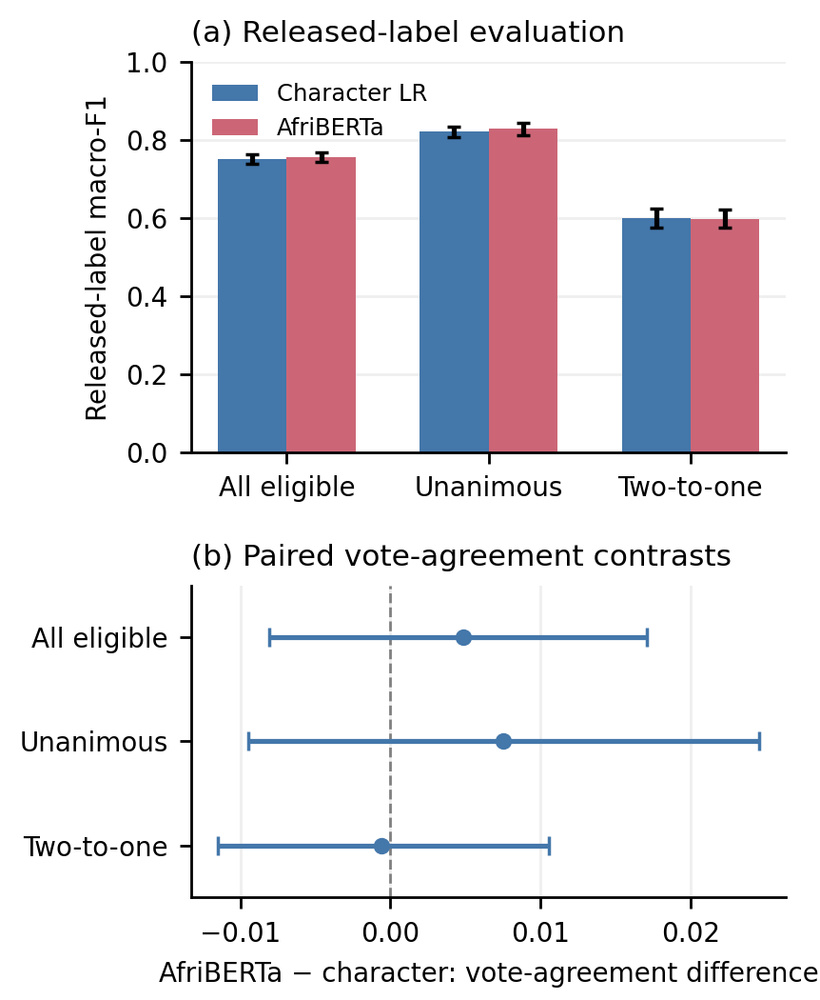

# When Annotators Disagree: Re-evaluating Hausa Sentiment Models Beyond a Single Label

Code, manuscript, aggregate results and provenance for a disagreement-aware
evaluation of **existing Hausa AfriSenti sentiment predictions**. This study
introduces no new corpus, participant recruitment, language-identification
labels or pragmatics annotations.

## Findings

- **5,303** original test posts; **4,562** eligible for the vote-linked analysis.
- Eligible patterns: **3,055 unanimous**, **1,501 two-to-one**, **six three-way**.
- CPU baselines plus nine encoder runs: AfriBERTa, mBERT and XLM-R, seeds 42–44.
- Overall point ordering is unchanged between released-label macro-F1 and
  empirical vote agreement **within eligible posts**. Eligibility changes the
  word-LR/mBERT ordering relative to the full test population.
- **64** eligible released labels differ from a unique raw-vote majority.
  These are consistency observations, not established annotation errors.

| Model | Released-label macro-F1 | Empirical vote agreement |
|---|---:|---:|
| AfriBERTa | 0.756 | 0.723 |
| Character TF–IDF + logistic regression | 0.753 | 0.718 |
| mBERT | 0.730 | 0.705 |
| Word TF–IDF + logistic regression | 0.726 | 0.693 |
| XLM-R | 0.699 | 0.675 |
| Majority class | 0.179 | 0.387 |

Encoder values average three recorded runs. AfriBERTa minus character LR
vote agreement is **+0.0048**, exploratory paired 95% interval
**[−0.0081, +0.0171]**. Neither a reliable advantage nor equivalence is
established. Disagreement groups differ in composition and metric ceilings;
score drops do not establish a causal ambiguity effect.



## Paper, results and provenance

| Item | File |
|---|---|
| Manuscript source | [paper/main.tex](paper/main.tex) |
| Protocol and exploratory scope | [DISAGREEMENT_PROTOCOL.md](DISAGREEMENT_PROTOCOL.md) |
| Targeted literature comparison | [LITERATURE_REVIEW.md](LITERATURE_REVIEW.md) |
| Aggregate results and intervals | [summary.json](results/disagreement/summary.json) |
| Coverage and sensitivity checks | [sensitivity.json](results/disagreement/sensitivity.json) |
| Source revision and file hashes | [source_manifest.json](provenance/source_manifest.json) |
| Encoder revisions and settings | [model_runs.json](provenance/model_runs.json) |
| Claim and submission audit | [MANUSCRIPT_REVIEW.md](MANUSCRIPT_REVIEW.md) |
| Data-sharing boundaries | [DATA_SHARING.md](DATA_SHARING.md) |
| Complete reproduction guide | [REPRODUCING.md](REPRODUCING.md) |

## Quick verification

```bash
git clone https://github.com/jefftrojan/hausa-sentiment-disagreement-audit.git
cd hausa-sentiment-disagreement-audit
python verify_artifact.py
python -m pip install -r requirements-analysis.txt
python build_disagreement_assets.py
```

Run verification before regenerating assets: rendering metadata can change
hashes across environments. The standard-library verifier checks integrity,
population accounting, aggregate numerical consistency, sensitivity agreement
and TeX dependencies. The last command rebuilds figures/tables from aggregates;
**it does not recompute predictions or the underlying evaluation**.

Exact saved-prediction reanalysis needs the separately obtained source and
authorized prediction files with recorded hashes. Retraining is an alternative,
with expected hardware/software variation. The pinned matrix runner defaults
to a dry-run plan; actual GPU training requires an explicit flag. See
[REPRODUCING.md](REPRODUCING.md). No new training is triggered by this release.

## Data and rights

Data come from the original
[AfriSenti repository](https://github.com/afrisenti-semeval/afrisent-semeval-2023),
revision `5aec3cfcf87b59f885e98641f72e52182776429d`. Cite
[NaijaSenti](https://aclanthology.org/2022.lrec-1.63/) and
[AfriSenti](https://arxiv.org/abs/2302.08956).
AfriSenti extends NaijaSenti; they are not independent corpora to pool.

The checked AfriSenti GitHub notice states CC BY 4.0; the related NaijaSenti
Hugging Face card states CC BY-NC-SA 4.0. These are different distributions;
neither is silently used to relicense the other or this project's original
code. No new project-wide code license is selected in this release. Public
availability alone is not a new reuse grant. Dependencies retain their own terms.

Raw/clean posts, individual votes, annotator identifiers, source-row joins,
per-item predictions, exclusion ledgers, credentials and model weights are
**not included**. Only code, manuscript, aggregate outputs and provenance are
published. Exact reanalysis is not possible from aggregate summaries alone.


